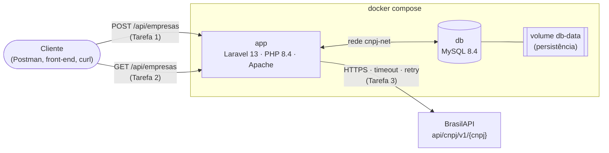
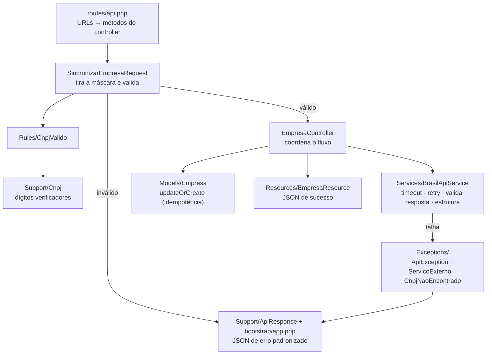

# API de Cadastro de Empresas por CNPJ

API em **PHP 8.4 / Laravel 13** que recebe um CNPJ, busca os dados da empresa na
[BrasilAPI](https://brasilapi.com.br/docs#tag/CNPJ), grava num banco relacional (MySQL no
Docker) e oferece endpoints para consultar o que já foi gravado.

| Tarefa | O que faz | Documento |
|---|---|---|
| 1 | Sincronização e persistência cadastral (`POST /api/empresas`) | [docs/TAREFA-1.md](docs/TAREFA-1.md) |
| 2 | Endpoints internos de consulta (`GET /api/empresas`, `GET /api/empresas/{cnpj}`) | [docs/TAREFA-2.md](docs/TAREFA-2.md) |
| 3 | Resiliência e tratamento de exceções (timeout, retry, erros padronizados) | [docs/TAREFA-3.md](docs/TAREFA-3.md) |
| 4 | Ambiente Docker (aplicação + MySQL via `docker compose`) | [docs/TAREFA-4.md](docs/TAREFA-4.md) |
| 5 | Testes automatizados (PHPUnit + `Http::fake()`) | [docs/TAREFA-5.md](docs/TAREFA-5.md) |
| 6 | Versionamento com Git (branches, commits, histórico) | [docs/TAREFA-6.md](docs/TAREFA-6.md) |

> Os diagramas deste README e dos documentos em `docs/` são feitos em **Mermaid**. O GitHub
> desenha os diagramas sozinho. No VS Code, instale a extensão *Markdown Preview Mermaid Support*
> e abra a pré-visualização com `Ctrl+Shift+V`.

## Visão geral



---

## Como rodar (Docker, recomendado)

**Pré-requisito:** só o [Docker](https://www.docker.com/products/docker-desktop/), com o
Docker Compose, que já vem no Docker Desktop. **Não** é preciso instalar PHP, Composer nem MySQL.

```bash
# 1. Na pasta do projeto, monte as imagens e suba os containers
docker compose up -d --build

# 2. Pronto. Na primeira vez leva uns minutos (download das imagens e dependências).
#    As tabelas são criadas automaticamente, porque as migrations rodam na inicialização.
```

A API fica disponível em **http://localhost:8000/api/empresas**.

Não é preciso criar `.env`: todos os valores têm padrão no `docker-compose.yml`. Para mudar
porta, senha etc., veja a [configuração](#configuração-variáveis-de-ambiente).

### Comandos úteis

| Comando | Para que serve |
|---|---|
| `docker compose ps` | Ver se os containers estão rodando (o `db` deve aparecer como `healthy`) |
| `docker compose logs -f app` | Acompanhar os logs da aplicação (Apache e Laravel) |
| `docker compose exec app php artisan test` | Rodar os testes automatizados **dentro** do container |
| `docker compose exec db mysql -ucnpj -psecret cnpj` | Abrir o console do MySQL |
| `docker compose down` | Parar e remover os containers (**os dados do banco continuam guardados**) |
| `docker compose down -v` | Parar e **apagar** também os dados do banco |
| `docker compose up -d --build` | Subir de novo depois de mudar o código |

### Testes automatizados

```bash
docker compose exec app php artisan test
```

São 49 testes da aplicação (validação de CNPJ, sincronização, persistência, idempotência,
consulta e resiliência), mais os 2 exemplos que já vêm com o Laravel. Os testes **não usam a
internet** (a BrasilAPI é simulada com `Http::fake()` e qualquer requisição real é bloqueada)
e **não mexem no MySQL**: eles rodam sempre num SQLite em memória. Detalhes na
[Tarefa 5](docs/TAREFA-5.md).

## Como rodar sem Docker (opcional)

Precisa ter PHP 8.3+ e Composer instalados. Usa SQLite, então não precisa de servidor de banco.

```bash
composer install
cp .env.example .env          # no Windows: copy .env.example .env
php artisan key:generate
php artisan migrate           # cria as tabelas no database/database.sqlite
php artisan serve             # sobe em http://localhost:8000
php artisan test              # roda os testes
```

---

## Exemplo rápido

```bash
# Cadastra (ou atualiza) a empresa. A máscara é opcional.
curl -X POST http://localhost:8000/api/empresas \
     -H "Content-Type: application/json" \
     -d '{"cnpj": "19.131.243/0001-97"}'

# Lista as empresas gravadas
curl http://localhost:8000/api/empresas

# Busca uma empresa específica (sem a "/" da máscara)
curl http://localhost:8000/api/empresas/19131243000197
```

No PowerShell:

```powershell
Invoke-RestMethod -Method Post -Uri http://localhost:8000/api/empresas -ContentType "application/json" -Body '{"cnpj":"19.131.243/0001-97"}'
```

---

## Organização do código

Cada classe cuida de uma coisa só. O caminho de uma requisição é este:



| Arquivo | Responsabilidade |
|---|---|
| [app/Support/Cnpj.php](app/Support/Cnpj.php) | Limpar, validar (incluindo o CNPJ alfanumérico) e formatar CNPJ |
| [app/Rules/CnpjValido.php](app/Rules/CnpjValido.php) | Regra de validação do Laravel, reutilizável |
| [app/Http/Requests/SincronizarEmpresaRequest.php](app/Http/Requests/SincronizarEmpresaRequest.php) | Validação da entrada do POST |
| [app/Services/BrasilApiService.php](app/Services/BrasilApiService.php) | Integração com a BrasilAPI e estruturação dos dados |
| [app/Exceptions/](app/Exceptions/) | Erros de negócio que já sabem montar a própria resposta HTTP |
| [app/Models/Empresa.php](app/Models/Empresa.php) | Model Eloquent |
| [database/migrations/2026_11_23_000000_create_empresas_table.php](database/migrations/2026_11_23_000000_create_empresas_table.php) | Estrutura da tabela |
| [app/Http/Resources/EmpresaResource.php](app/Http/Resources/EmpresaResource.php) | Formato do JSON de saída |
| [app/Http/Controllers/EmpresaController.php](app/Http/Controllers/EmpresaController.php) | Endpoints |
| [config/services.php](config/services.php) | URL e timeout da BrasilAPI (chave `brasilapi`) |
| [tests/](tests/) | Testes unitários (CNPJ) e de ponta a ponta (endpoints) |
| [Dockerfile](Dockerfile) | Imagem da aplicação (PHP 8.4 + Apache) |
| [docker-compose.yml](docker-compose.yml) | Containers da aplicação e do MySQL, rede, volume e variáveis |
| [docker/](docker/) | Script de inicialização (`entrypoint.sh`) e configuração do Apache |

Todos os arquivos acima têm comentários explicando o **porquê** de cada decisão.

---

## Configuração (variáveis de ambiente)

No Docker, as variáveis abaixo podem ser definidas num arquivo `.env` na raiz do projeto.
O Docker Compose lê esse arquivo sozinho. Sem ele, valem os padrões.

| Variável | Padrão | Para que serve |
|---|---|---|
| `APP_PORT` | `8000` | Porta da API no seu computador |
| `APP_KEY` | *(gerada na inicialização)* | Chave de criptografia do Laravel. Em produção, defina uma fixa |
| `DB_DATABASE` | `cnpj` | Nome do banco MySQL |
| `DB_USERNAME` | `cnpj` | Usuário do banco (não use `root`: a imagem do MySQL não aceita) |
| `DB_PASSWORD` | `secret` | Senha desse usuário |
| `DB_ROOT_PASSWORD` | `root` | Senha do root do MySQL |
| `DB_FORWARD_PORT` | `3307` | Porta para acessar o MySQL de fora (DBeaver, Workbench) |
| `BRASILAPI_URL` | `https://brasilapi.com.br/api` | URL base da API externa |
| `BRASILAPI_CONNECT_TIMEOUT` | `5` | Tempo máximo para conectar na API externa, em segundos |
| `BRASILAPI_TIMEOUT` | `10` | Tempo máximo da requisição à API externa, em segundos |
| `BRASILAPI_TENTATIVAS` | `2` | Total de tentativas em falhas temporárias (1 = não tenta de novo) |
| `BRASILAPI_INTERVALO_MS` | `300` | Espera entre as tentativas, em milissegundos |

> As senhas padrão servem **só para desenvolvimento e avaliação**. Em produção, elas devem vir de um `.env` que não vai para o Git, ou de um gerenciador de segredos.

Sem Docker, a configuração fica no `.env` normal do Laravel (`DB_CONNECTION=sqlite` por padrão).
