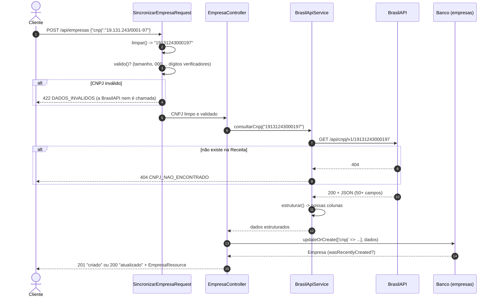
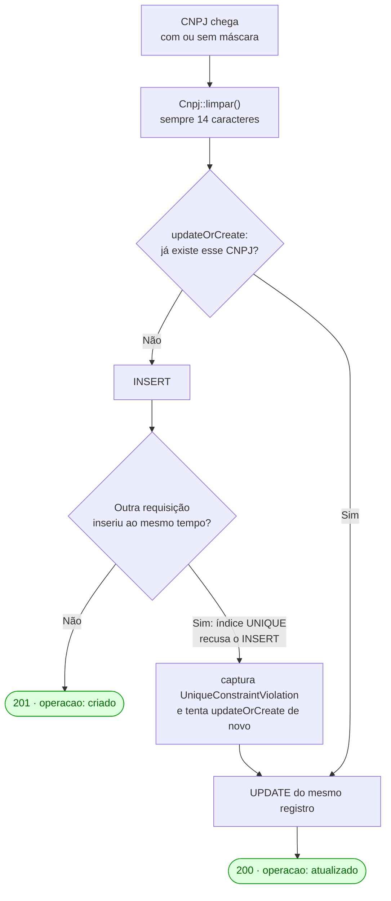
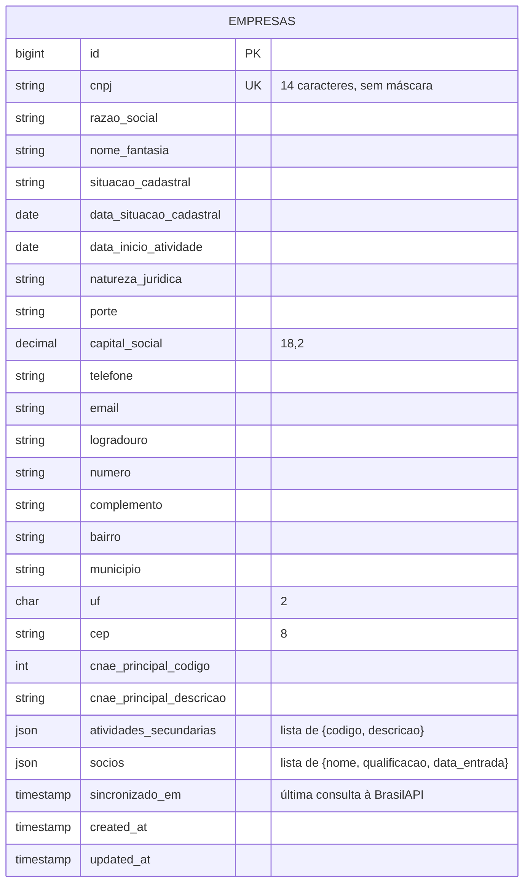

# Tarefa 1: Sincronização e Persistência Cadastral

> Desenvolver um endpoint que receba um número de CNPJ, com ou sem máscara, consulte
> uma API pública externa, estruture os dados, grave no banco local e devolva JSON.
> Se o mesmo CNPJ for enviado de novo, o registro existente deve ser atualizado, sem duplicar.

## Endpoint

```
POST /api/empresas
Content-Type: application/json

{ "cnpj": "19.131.243/0001-97" }      ← com máscara
{ "cnpj": "19131243000197" }          ← ou sem máscara
```

## Fluxo da requisição



## Como cada requisito foi atendido

| Requisito | Onde | Como |
|---|---|---|
| Receber e validar o CNPJ | `SincronizarEmpresaRequest` + `Rules/CnpjValido` + `Support/Cnpj` | Confere o tamanho, os caracteres permitidos, recusa sequências repetidas (`000...`) e calcula os 2 dígitos verificadores (módulo 11) |
| Remover a formatação | `Support/Cnpj::limpar()`, chamado no `prepareForValidation()` | Remove `.` `/` `-` e espaços antes de validar. A API externa e o banco recebem sempre os 14 caracteres limpos |
| Consumir a API externa | `Services/BrasilApiService::consultarCnpj()` | `GET https://brasilapi.com.br/api/cnpj/v1/{cnpj}`, com timeout |
| Estruturar os dados | `BrasilApiService::estruturar()` + `EmpresaResource` | Escolhe os campos relevantes, renomeia, troca `""` por `null`, agrupa o endereço e a atividade principal e limpa listas |
| Persistir no banco local | `Models/Empresa` + migration | MySQL no Docker ([Tarefa 4](TAREFA-4.md)) ou SQLite sem Docker. O banco muda só pela variável `DB_CONNECTION` |
| Retornar JSON | `EmpresaResource` | Mesmo formato em todos os endpoints |
| Idempotência | Índice `UNIQUE` em `cnpj` + `updateOrCreate` | Veja a seção abaixo |

## Regra de idempotência (o ponto principal da tarefa)



A garantia tem duas camadas:

1. Na aplicação: `Empresa::updateOrCreate(['cnpj' => $cnpj], $dados)`. Se o CNPJ já existe,
   o registro é atualizado. Se não existe, é criado.
2. No banco: a coluna `cnpj` tem índice UNIQUE. Mesmo que o código tenha algum bug, o
   banco recusa um CNPJ duplicado.

Como o CNPJ é gravado sempre sem máscara, `19.131.243/0001-97` e `19131243000197` são
reconhecidos como a mesma empresa.

Requisições ao mesmo tempo: se duas requisições com o mesmo CNPJ *novo* chegarem juntas,
as duas podem "não achar" o registro e tentar criar. O índice UNIQUE deixa só uma conseguir. A
outra recebe `UniqueConstraintViolationException`, e o controller tenta de novo. Na segunda
tentativa o registro já existe, então vira uma atualização. Nenhuma requisição dá erro e não há
duplicidade.

Quem chamou sabe o que aconteceu:

| Situação | HTTP | `operacao` |
|---|---|---|
| CNPJ novo | 201 Created | `"criado"` |
| CNPJ já existente | 200 OK | `"atualizado"` |

Também há o campo `sincronizado_em`, atualizado em toda consulta à BrasilAPI. O `atualizado_em`
(`updated_at`) só muda quando algum dado mudou de fato.

## Tabela `empresas`



## Exemplo de resposta (dados reais da BrasilAPI)

```json
{
  "data": {
    "id": 1,
    "cnpj": "19131243000197",
    "cnpj_formatado": "19.131.243/0001-97",
    "razao_social": "OPEN KNOWLEDGE BRASIL",
    "nome_fantasia": "REDE PELO CONHECIMENTO LIVRE",
    "situacao_cadastral": "ATIVA",
    "data_situacao_cadastral": "2013-10-03",
    "data_inicio_atividade": "2013-10-03",
    "natureza_juridica": "Associação Privada",
    "porte": "DEMAIS",
    "capital_social": 0,
    "telefone": "1123851939",
    "email": null,
    "endereco": {
      "logradouro": "AVENIDA PAULISTA 37",
      "numero": "37",
      "complemento": "ANDAR 4",
      "bairro": "BELA VISTA",
      "municipio": "SAO PAULO",
      "uf": "SP",
      "cep": "01311902"
    },
    "atividade_principal": {
      "codigo": 9430800,
      "descricao": "Atividades de associações de defesa de direitos sociais"
    },
    "atividades_secundarias": [
      { "codigo": 6204000, "descricao": "Consultoria em tecnologia da informação" }
    ],
    "socios": [
      { "nome": "LUIZ CARLOS PINHO GUEDES", "qualificacao": "Diretor", "data_entrada": "2026-09-10" }
    ],
    "sincronizado_em": "2026-11-23T12:40:01+00:00",
    "criado_em": "2026-11-23T12:40:01+00:00",
    "atualizado_em": "2026-11-23T12:40:01+00:00"
  },
  "operacao": "criado"
}
```

*(As atividades secundárias foram resumidas aqui. A resposta real traz as 5.)*

## Erros

| Situação | HTTP | Exemplo de corpo |
|---|---|---|
| CNPJ ausente, mal formatado ou com dígito verificador errado | 422 | `{"message": "O CNPJ informado é inválido.", "codigo": "DADOS_INVALIDOS", "errors": {"cnpj": [...]}}` |
| CNPJ válido, mas que não existe na Receita | 404 | `{"message": "CNPJ não encontrado na base da Receita Federal.", "codigo": "CNPJ_NAO_ENCONTRADO"}` |
| BrasilAPI com erro, fora do ar, lenta ou com limite excedido | 502 / 503 / 504 | Veja a tabela completa na [Tarefa 3](TAREFA-3.md#tabela-de-situações) |

No caso de 422, a API externa nem chega a ser chamada, o que economiza tempo e o limite de requisições.

## Observações

- CNPJ alfanumérico: desde julho/2026 a Receita emite CNPJs com letras nas 12 primeiras
  posições (ex.: `12.ABC.345/01DE-35`). A validação já aceita esse formato: cada caractere vale
  `ASCII - 48` no cálculo, o que é compatível com os CNPJs numéricos antigos. Por isso o CNPJ é
  guardado como `string(14)` e nunca como número, o que também evita perder os zeros à esquerda.
- URL do enunciado: veio sem a barra antes do CNPJ (`/api/cnpj/v1{cnpj}`). O correto é `/api/cnpj/v1/{cnpj}`.
- Limpeza dos dados: a BrasilAPI manda `nome_fantasia: ""` quando não há nome fantasia e
  `cnaes_secundarios: [{codigo: 0, descricao: ""}]` quando não há atividade secundária. Esses
  casos são convertidos para `null` e `[]`.
- Logradouro: a BrasilAPI separa o tipo ("AVENIDA") do nome ("PAULISTA 37"). Os dois são juntados sem repetir o tipo.

## Melhorias e alternativas

1. Sócios e CNAEs em JSON ou em tabelas próprias? Escolhi JSON porque esses dados são
   sempre lidos junto com a empresa. Se for preciso buscar "todas as empresas de um sócio",
   valeria criar as tabelas `empresa_socios` e `empresa_cnaes`.
2. Cache: hoje, todo POST consulta a BrasilAPI. Daria para pular a consulta se
   `sincronizado_em` for recente (ex.: menos de 24h), economizando requisições.
3. Fallback: se a BrasilAPI cair, poderíamos tentar outra API (ReceitaWS, CNPJá). O
   `BrasilApiService` já está isolado, o que facilita criar uma interface com mais de uma implementação.
4. Retry: implementado na [Tarefa 3](TAREFA-3.md), só para falhas temporárias (rede e 5xx).
   Não há nova tentativa em 429, para não piorar o excesso de requisições.
5. Autenticação e rate limit: o endpoint está aberto. Em produção, valeria usar Sanctum
   (já instalado) e `throttle` na rota.
6. Fila (Queue): para sincronizar muitos CNPJs de uma vez, o ideal seria colocar as consultas numa fila (job assíncrono).

## Testes que cobrem esta tarefa

Em [tests/Feature/EmpresaApiTest.php](../tests/Feature/EmpresaApiTest.php) e [tests/Unit/CnpjTest.php](../tests/Unit/CnpjTest.php):

- CNPJ com máscara cria a empresa (201), consulta a API sem máscara e estrutura os dados
- Reenviar o mesmo CNPJ (agora sem máscara) atualiza (200) e continua com 1 registro
- CNPJ inválido dá 422 e não chama a API externa
- CNPJ inexistente dá 404 e falha da API externa dá 502 (nada é gravado)
- Validação: com e sem máscara, alfanumérico, dígito errado, sequência repetida etc.
