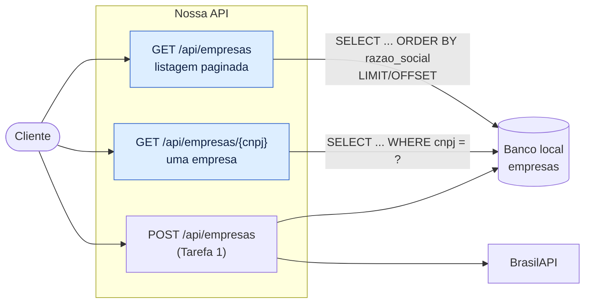
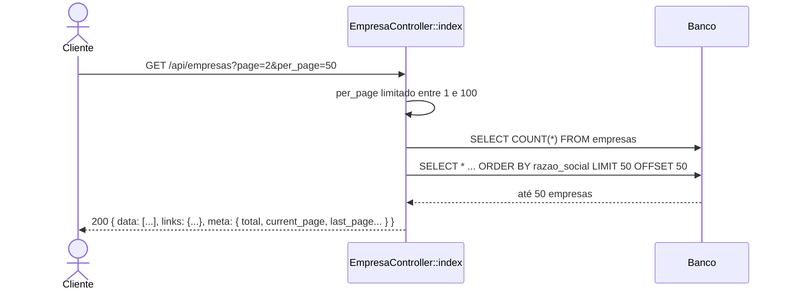
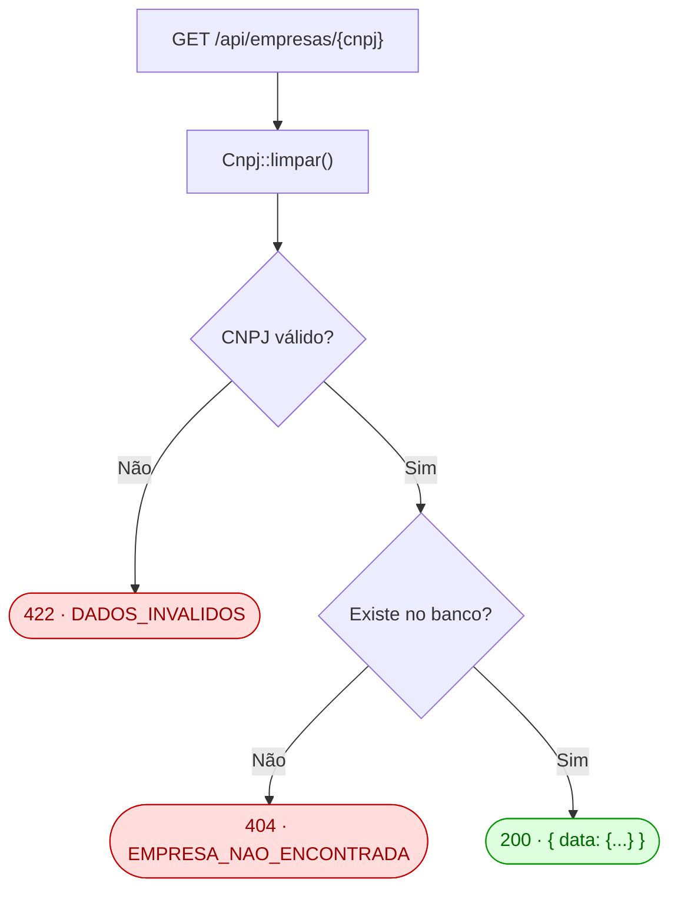

# Tarefa 2: Endpoints Internos de Consulta

> Disponibilizar endpoints para consulta dos dados armazenados localmente.
> Listagem geral: criar um endpoint para listar as empresas cadastradas no banco de dados.

Estes endpoints só leem o banco local. Eles nunca chamam a BrasilAPI, por isso são
rápidos e funcionam mesmo se a API externa estiver fora do ar. Para atualizar os dados de uma
empresa, use o `POST /api/empresas` da [Tarefa 1](TAREFA-1.md).



Os endpoints em azul só leem o banco. A BrasilAPI só é chamada pelo POST da Tarefa 1.

## Listagem geral

```
GET /api/empresas
GET /api/empresas?page=2
GET /api/empresas?per_page=50
```



| Parâmetro | Padrão | Descrição |
|---|---|---|
| `page` | `1` | Página desejada |
| `per_page` | `15` | Itens por página (mínimo 1, máximo 100) |

A lista vem ordenada por razão social.

### Por que paginar?

A tarefa pede "listar as empresas". Sem paginação, com 50 mil empresas no banco, uma só
requisição devolveria tudo: resposta enorme, lenta e pesada para o servidor. Com paginação, o
cliente pede uma página por vez e recebe o total de registros para montar a navegação.
O limite de 100 por página impede que alguém peça `per_page=1000000`.

### Exemplo de resposta

```json
{
  "data": [
    {
      "id": 1,
      "cnpj": "19131243000197",
      "cnpj_formatado": "19.131.243/0001-97",
      "razao_social": "OPEN KNOWLEDGE BRASIL",
      "...": "mesmos campos da Tarefa 1"
    }
  ],
  "links": {
    "first": "http://localhost:8000/api/empresas?page=1",
    "last": "http://localhost:8000/api/empresas?page=1",
    "prev": null,
    "next": null
  },
  "meta": {
    "current_page": 1,
    "last_page": 1,
    "per_page": 15,
    "total": 1,
    "from": 1,
    "to": 1
  }
}
```

Cada item de `data` usa o mesmo formato do POST da Tarefa 1, porque os dois usam o
`EmpresaResource`. Quem consome a API só precisa conhecer um formato de empresa.

## Consulta de uma empresa (extra)

Não foi pedido de forma explícita, mas completa o "endpoints para consulta" (no plural):

```
GET /api/empresas/19131243000197
GET /api/empresas/19.131.243.0001-97     ← pontos e hífen são aceitos
```

> A barra `/` da máscara não pode ir na URL, porque ela separa as partes do caminho.
> Por isso o CNPJ deve ir sem ela.



| Situação | HTTP |
|---|---|
| Empresa encontrada | 200, com `{"data": {...}}` |
| CNPJ válido, mas não gravado no banco | 404: `{"message": "Empresa não cadastrada no banco local.", "codigo": "EMPRESA_NAO_ENCONTRADA"}` |
| CNPJ inválido | 422: `{"message": "O CNPJ informado é inválido.", "codigo": "DADOS_INVALIDOS", "errors": {...}}` |

## Onde está no código

- Rotas: [routes/api.php](../routes/api.php)
- `EmpresaController::index()` (listagem) e `EmpresaController::show()` (uma empresa): [app/Http/Controllers/EmpresaController.php](../app/Http/Controllers/EmpresaController.php)
- Formato da resposta: [app/Http/Resources/EmpresaResource.php](../app/Http/Resources/EmpresaResource.php)

## Melhorias e alternativas

1. Filtros: seria útil ter `?uf=MT`, `?situacao=ATIVA` ou `?busca=nome`. O endereço já foi
   gravado em colunas separadas (e não em JSON) justamente para permitir esse tipo de filtro.
2. Índices: se os filtros acima forem criados, vale adicionar índices nas colunas `uf`,
   `situacao_cadastral` e `razao_social`.
3. Listagem resumida: a listagem devolve a empresa completa (com sócios e CNAEs). Se ficar
   pesada, dá para criar um `EmpresaResumoResource` só com CNPJ, razão social, UF e situação.
4. Paginação por cursor: com volumes muito grandes, o `cursorPaginate()` é mais eficiente que a paginação por número de página.

## Testes que cobrem esta tarefa

Em [tests/Feature/EmpresaApiTest.php](../tests/Feature/EmpresaApiTest.php):

- A listagem devolve as empresas do banco, ordenadas e paginadas, sem chamar a API externa
- A listagem vazia devolve `data: []`
- A busca por CNPJ funciona com e sem máscara, devolve 404 para CNPJ não cadastrado e 422 para CNPJ inválido
