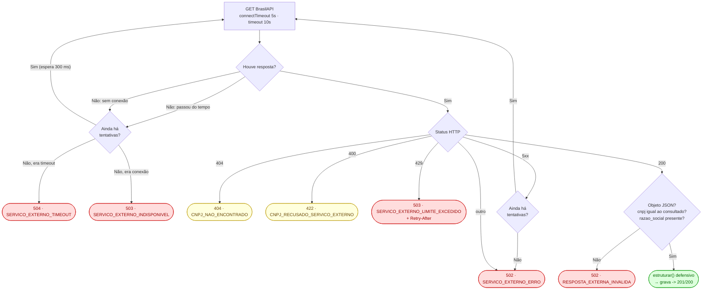
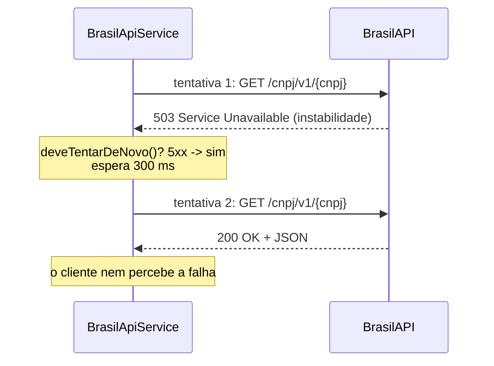
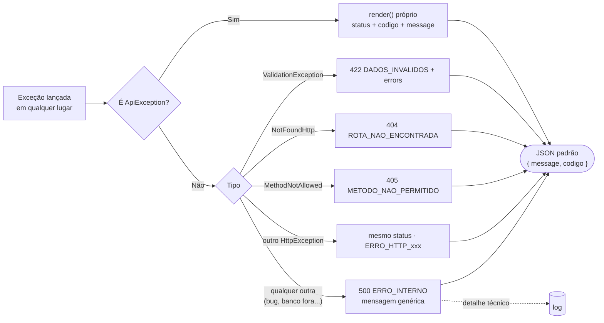

# Tarefa 3: Resiliência e Tratamento de Exceções

> A aplicação deve tratar falhas de comunicação e situações inesperadas na integração com o
> serviço externo: timeout, erros de conexão, respostas inválidas e códigos HTTP adequados, sem
> deixar exceções não tratadas chegarem ao consumidor. As respostas devem ter uma estrutura
> consistente e mensagens compreensíveis.

## Formato padrão de erro

Todo erro da API, seja nosso ou do framework, sai neste formato:

```json
{
  "message": "A BrasilAPI demorou demais para responder. Tente novamente em instantes.",
  "codigo": "SERVICO_EXTERNO_TIMEOUT"
}
```

| Campo | Para quem | Uso |
|---|---|---|
| `message` | Pessoas | Texto em português que pode ir direto para a tela de quem usa a API |
| `codigo` | Programas | Valor fixo para o cliente tratar com `if`, sem depender do texto |
| `errors` | Programas | Só nos erros de validação (422): os erros de cada campo |

Exemplo de validação:

```json
{
  "message": "O CNPJ informado é inválido.",
  "codigo": "DADOS_INVALIDOS",
  "errors": { "cnpj": ["O CNPJ informado é inválido."] }
}
```

O formato é montado num único lugar: [app/Support/ApiResponse.php](../app/Support/ApiResponse.php).

## Como cada resposta da BrasilAPI é tratada



Amarelo = problema no pedido (4xx). Vermelho = problema no serviço externo (5xx). Verde = sucesso.

### Nova tentativa automática em falha temporária



## Tabela de situações

| Situação | HTTP | `codigo` | Tenta de novo? |
|---|---|---|---|
| CNPJ ausente ou inválido | 422 | `DADOS_INVALIDOS` | Não chega a consultar |
| CNPJ não existe na Receita (BrasilAPI 404) | 404 | `CNPJ_NAO_ENCONTRADO` | Não |
| BrasilAPI recusou o CNPJ (400) | 422 | `CNPJ_RECUSADO_SERVICO_EXTERNO` | Não |
| Limite de requisições da BrasilAPI (429) | 503 + `Retry-After` | `SERVICO_EXTERNO_LIMITE_EXCEDIDO` | Não |
| BrasilAPI com erro 5xx | 502 | `SERVICO_EXTERNO_ERRO` | Sim |
| Passou do tempo limite (timeout) | 504 | `SERVICO_EXTERNO_TIMEOUT` | Sim |
| Não conectou (DNS, rede, conexão recusada) | 503 | `SERVICO_EXTERNO_INDISPONIVEL` | Sim |
| Status 200, mas o corpo não é JSON ou faltam campos | 502 | `RESPOSTA_EXTERNA_INVALIDA` | Não |
| Status 200, mas com outro CNPJ | 502 | `RESPOSTA_EXTERNA_INVALIDA` | Não |
| Empresa não está no banco local (`GET /api/empresas/{cnpj}`) | 404 | `EMPRESA_NAO_ENCONTRADA` | n/a |
| Rota inexistente | 404 | `ROTA_NAO_ENCONTRADA` | n/a |
| Método errado (ex.: `DELETE /api/empresas`) | 405 | `METODO_NAO_PERMITIDO` | n/a |
| Qualquer erro inesperado (bug, banco fora do ar...) | 500 | `ERRO_INTERNO` | n/a |

### Por que esses códigos?

- 4xx = o problema está no pedido do cliente. Repetir sem mudar nada não adianta.
- 502 Bad Gateway: o serviço do qual a aplicação depende respondeu algo errado.
- 503 Service Unavailable: o serviço está fora do ar ou sobrecarregado *agora*. Vale tentar
  depois. No caso do 429, a API repassa o `Retry-After` da BrasilAPI.
- 504 Gateway Timeout: o serviço não respondeu a tempo.
- 500: só para erro nosso. Separar 500 de 502/503/504 facilita o monitoramento: um 500
  indica bug na aplicação, e um 502/503/504 indica problema no fornecedor externo.

> Por que 429 da BrasilAPI vira 503 e não 429? O 429 diria ao cliente "*você* mandou
> requisições demais", mas quem estourou o limite foi a nossa aplicação junto à BrasilAPI.

## Como cada requisito foi atendido

### 1. Timeout na comunicação HTTP

Em [BrasilApiService::consultarCnpj()](../app/Services/BrasilApiService.php), com dois limites
configuráveis em [config/services.php](../config/services.php):

| Configuração | Padrão | O que limita |
|---|---|---|
| `BRASILAPI_CONNECT_TIMEOUT` | 5 s | Tempo para abrir a conexão. É onde um servidor fora do ar costuma travar |
| `BRASILAPI_TIMEOUT` | 10 s | Tempo da requisição inteira |

### 2. Erros de conexão e indisponibilidade

- O `ConnectionException` do Laravel é capturado e separado em timeout (erro 28 do cURL), que
  vira 504, e falha de conexão, que vira 503.
- Retry automático só nas falhas temporárias: erro de rede e 5xx. Por padrão são 2
  tentativas, com 300 ms de intervalo.
  - Não tenta de novo em 404 e 400, porque a resposta seria a mesma.
  - Não tenta de novo em 429, porque repetir na hora só aumenta o excesso de requisições.

### 3. Respostas inválidas ou inesperadas

Nada que vem de fora é tratado como confiável. Antes de usar a resposta, o `validarResposta()` confere:

1. o corpo é um objeto JSON. Um proxy ou uma página de manutenção pode devolver HTML com status 200;
2. existe o campo `cnpj` e ele é igual ao consultado;
3. existe `razao_social` em formato de texto.

Depois disso, o `estruturar()` trata cada campo com cuidado: um texto que veio como lista
vira `null`, uma data num formato diferente vira `null`, e uma lista que veio como texto vira
`[]`. Um campo estranho não derruba a requisição inteira.

Os detalhes técnicos (o motivo da resposta ser inválida, o status recebido) vão só para o log.
O cliente recebe a mensagem genérica.

### 4. Códigos HTTP adequados

Veja a tabela acima. Cada situação tem um método próprio em
[ServicoExternoException](../app/Exceptions/ServicoExternoException.php), então todas as
possibilidades ficam visíveis num lugar só.

### 5. Nenhuma exceção não tratada chega ao consumidor



Em [bootstrap/app.php](../bootstrap/app.php) há um tratamento central para `/api/*`:

| Exceção | Resposta |
|---|---|
| `ApiException` (as nossas) | Usa o próprio `render()`, com status, código e mensagem definidos |
| `ValidationException` | 422 `DADOS_INVALIDOS` + `errors` |
| `NotFoundHttpException` | 404 `ROTA_NAO_ENCONTRADA` |
| `MethodNotAllowedHttpException` | 405 `METODO_NAO_PERMITIDO` |
| Outros erros HTTP do framework | Mantém o status, `ERRO_HTTP_<status>` |
| Qualquer outra (`Throwable`) | 500 `ERRO_INTERNO`, com mensagem genérica |

O último item é a rede de segurança: mesmo um bug sai como JSON no formato padrão, sem
stack trace, nome de classe, SQL ou caminho de arquivo. Isso vale mesmo com `APP_DEBUG=true`.
O detalhe completo continua no log (`docker compose logs app`).

O que vai para o log:

- erros 4xx são comportamento normal, como "CNPJ não existe", e não sujam o log;
- erros 5xx vão para o log, com o código e o motivo técnico como contexto.

## Arquivos

| Arquivo | Papel |
|---|---|
| [app/Support/ApiResponse.php](../app/Support/ApiResponse.php) | Monta o JSON de erro padrão |
| [app/Exceptions/ApiException.php](../app/Exceptions/ApiException.php) | Base dos erros esperados: status, código, render e regra de log |
| [app/Exceptions/ServicoExternoException.php](../app/Exceptions/ServicoExternoException.php) | Um método para cada tipo de falha da BrasilAPI |
| [app/Exceptions/CnpjNaoEncontradoException.php](../app/Exceptions/CnpjNaoEncontradoException.php) | 404 da Receita |
| [app/Services/BrasilApiService.php](../app/Services/BrasilApiService.php) | Timeout, retry, validação da resposta e estruturação defensiva |
| [bootstrap/app.php](../bootstrap/app.php) | Tratamento central (rede de segurança) |
| [tests/Feature/ResilienciaApiTest.php](../tests/Feature/ResilienciaApiTest.php) | 17 testes cobrindo cada linha da tabela de situações |

## Melhorias e alternativas

1. Circuit breaker: se a BrasilAPI cair de vez, toda requisição ainda espera o timeout (até
   ~20 s com a nova tentativa). Um circuit breaker "abriria o circuito" depois de N falhas e
   responderia 503 na hora durante alguns minutos.
2. Fallback com dados locais: se a BrasilAPI falhar e o CNPJ já estiver no banco, poderíamos
   devolver os dados gravados com um aviso (`"desatualizado": true`) em vez do erro.
3. Fallback para outra API: tentar ReceitaWS ou CNPJá quando a BrasilAPI falhar.
4. Backoff exponencial: esperar 300 ms, depois 600 ms, depois 1,2 s... em vez de um intervalo fixo.
5. 429 -> 503 ou 429? Veja a nota acima.
6. Rastreabilidade: incluir um `request_id` em toda resposta de erro, para o suporte achar o log daquela requisição.
