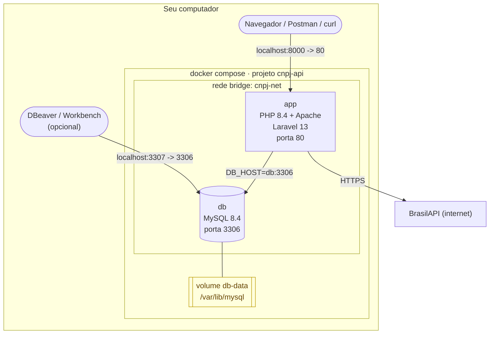
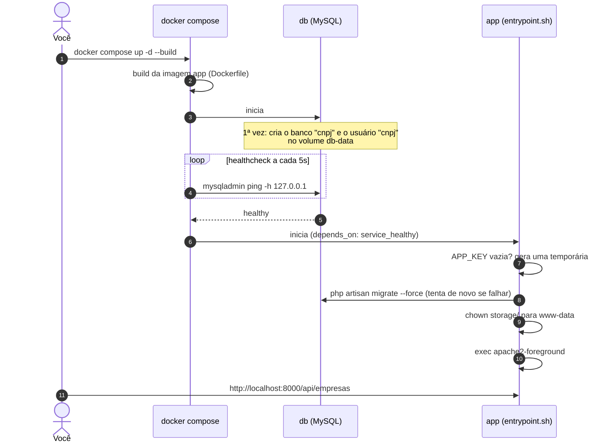
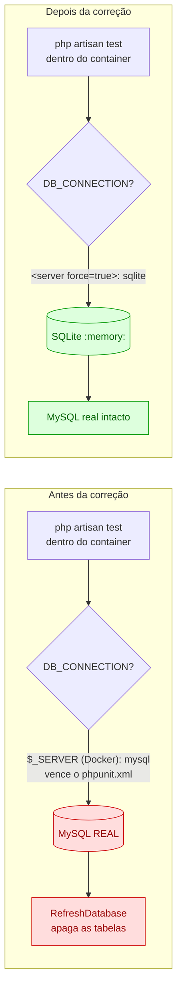

# Tarefa 4: Docker e Ambiente de Execução

> O projeto deve rodar em Docker, sem precisar instalar PHP e banco de dados na máquina do
> avaliador. O ambiente deve subir com `docker compose`, seguindo as instruções do README.md.

## Como subir

```bash
docker compose up -d --build
```

Depois é só acessar http://localhost:8000/api/empresas. As instruções completas e os comandos
úteis estão no [README.md](../README.md#como-rodar-docker-recomendado).

## Visão geral



## Como cada requisito foi atendido

| Requisito | Onde | Como |
|---|---|---|
| Dockerfile da aplicação | [Dockerfile](../Dockerfile) | Imagem `php:8.4-apache` com `pdo_mysql`, `mod_rewrite`, Composer e o código |
| docker-compose.yml | [docker-compose.yml](../docker-compose.yml) | Dois serviços: `app` e `db` |
| Container da aplicação Laravel | serviço `app` | Apache servindo `public/`. O [entrypoint.sh](../docker/entrypoint.sh) roda as migrations antes de subir |
| Container de banco relacional | serviço `db` | `mysql:8.4` (versão LTS), com healthcheck |
| Comunicação entre os containers | rede `cnpj-net` (bridge) | O `app` acessa o banco pelo nome do serviço: `DB_HOST=db` |
| Variáveis de ambiente | bloco `environment` do compose | Valores no formato `${VAR:-padrão}`: funciona sem configurar nada e pode ser trocado por um `.env` |
| Persistência dos dados | volume nomeado `db-data` | `/var/lib/mysql` fica fora do container. Os dados continuam depois de `down`, de um rebuild e de reiniciar o PC |
| Subir com `docker compose`, seguindo o README | [README.md](../README.md) | `docker compose up -d --build` |

## O que acontece no `docker compose up`



1. Build: o Docker monta a imagem `app` a partir do `Dockerfile`, instalando as dependências PHP com o Composer.
2. `db` sobe primeiro. Na primeira vez, o MySQL cria o banco `cnpj` e o usuário `cnpj`.
3. Healthcheck: o Compose espera o `mysqladmin ping` responder.
   Só então o `app` é iniciado (`depends_on: condition: service_healthy`).
4. `entrypoint.sh` do `app`:
   - gera uma `APP_KEY` temporária, se nenhuma foi definida;
   - roda `php artisan migrate --force`, que cria as tabelas, e tenta de novo se o banco ainda não responder;
   - acerta as permissões de `storage/` para o usuário do Apache;
   - sobe o Apache.

## Decisões e detalhes

- Por que MySQL e não SQLite no Docker? A tarefa pede um *container* de banco relacional.
  O código não mudou nada: o Laravel troca de banco só pela variável `DB_CONNECTION`. Sem
  Docker, o projeto continua funcionando com SQLite.
- Por que Apache e não Nginx + PHP-FPM? Um container a menos e configuração mais simples
  para uma API pequena. Para escalar em produção, PHP-FPM + Nginx é o mais comum.
- Cache de build: o `Dockerfile` copia o `composer.json`/`composer.lock` antes do resto
  do código. Se só o código mudar, o Docker reaproveita a camada das dependências e o rebuild fica rápido.
- `.dockerignore`: não deixa `vendor/`, `.env`, o banco SQLite local e os logs entrarem na
  imagem. Assim a imagem fica menor e nenhum segredo local vai parar nela.
- Healthcheck com `-h 127.0.0.1`: durante a primeira inicialização, o MySQL sobe um servidor
  temporário sem rede. Forçar a conexão por TCP evita o Compose achar que o banco está pronto antes da hora.
- Logs: `LOG_CHANNEL=stderr` faz os logs do Laravel aparecerem em `docker compose logs app`, junto com os do Apache.
- Porta 3307 para o MySQL: fica exposta só para facilitar a inspeção (DBeaver/Workbench) e
  não conflita com um MySQL local na 3306. Em produção, essa porta não deveria ser exposta.

## Problema encontrado durante o desenvolvimento

Ao rodar `php artisan test` dentro do container, os testes apagaram o banco MySQL real.



Por quê: os testes usam `RefreshDatabase`, que recria as tabelas. O `phpunit.xml` mandava
usar SQLite em memória, mas só se a variável ainda não existisse. No container, o Docker já
definia `DB_CONNECTION=mysql`. E o Laravel lê primeiro o `$_SERVER`, onde ficam as variáveis do
Docker. Por isso nem o `<env force="true">` resolveu sozinho.

Correção: no [phpunit.xml](../phpunit.xml), as variáveis críticas passaram a ser definidas com
`<server name="DB_CONNECTION" value="sqlite" force="true"/>`. Validei assim: com 1 registro no
MySQL, rodei a suíte de testes e o registro continuou lá.

Conclusão: testes que limpam o banco precisam ser isolados de forma explícita do banco real.
Não dá para confiar em "padrões".

## Verificações feitas

| Verificação | Resultado |
|---|---|
| `docker compose up -d --build` do zero | `db` healthy, `app` no ar, migrations rodadas |
| `POST /api/empresas` com máscara (BrasilAPI real) | 201, gravado no MySQL |
| Reenvio do mesmo CNPJ | 200 `atualizado`, continua com 1 registro |
| `docker compose down` + `up --build` | Registro continuou lá (persistência OK) |
| `docker compose exec app php artisan test` | Todos os testes passando, MySQL intacto |

## Melhorias e alternativas

1. Imagem de produção: separar as imagens de dev e prod (multi-stage), com `composer install --no-dev`,
   `php artisan config:cache`/`route:cache` e OPcache ligado.
2. Segredos: em produção, usar Docker secrets ou um cofre em vez de senhas no compose.
3. Código montado como volume (dev): montar `.:/var/www/html` deixaria editar o código sem
   rebuild. Não fiz isso porque a tarefa pede um ambiente para *avaliação*, e a imagem fechada é mais previsível.
4. Migrations na inicialização: é prático, mas com várias réplicas da aplicação o ideal é
   rodar as migrations num passo separado do deploy.
