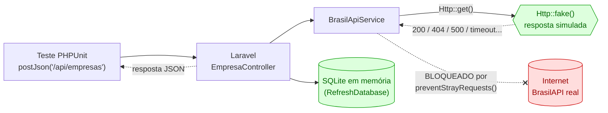
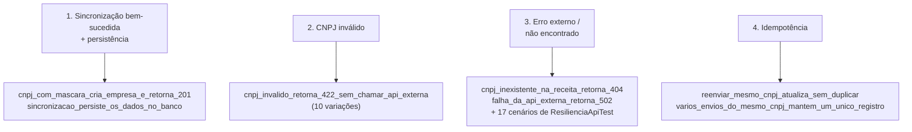
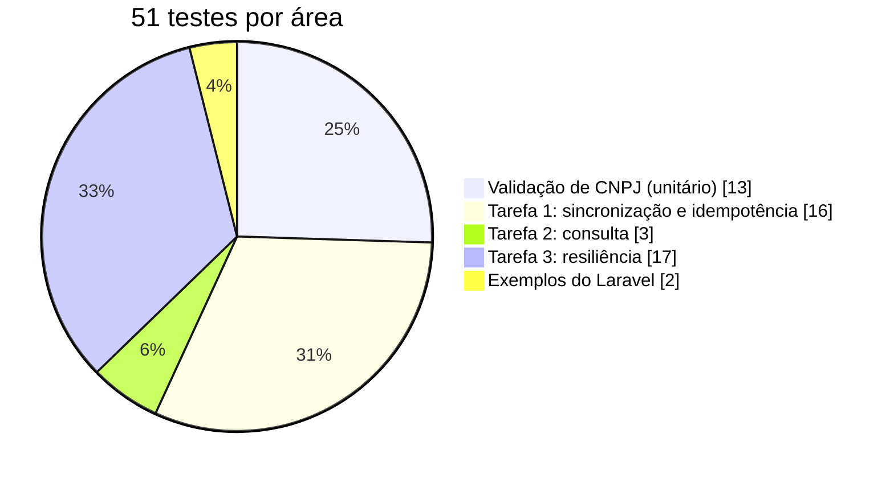

# Tarefa 5: Testes Automatizados

> Implementar testes automatizados com PHPUnit cobrindo, no mínimo: (1) sincronização
> bem-sucedida, simulando a API externa e validando a persistência; (2) CNPJ inválido;
> (3) serviço externo com erro ou registro não encontrado; (4) idempotência.
> Os testes não devem fazer requisições HTTP reais. Use `Http::fake()`.

## Como rodar

```bash
docker compose exec app php artisan test      # com Docker
php artisan test                              # sem Docker
php artisan test --filter=Resiliencia         # só uma classe/teste
```

Resultado atual: 51 testes, 218 verificações, todos passando (~1 s dentro do container).

## Como os testes ficam isolados



Três garantias trabalham juntas:

| Garantia | Onde | O que faz |
|---|---|---|
| `Http::fake()` | Em cada teste | Troca a BrasilAPI por respostas definidas no próprio teste |
| `Http::preventStrayRequests()` | [tests/TestCase.php](../tests/TestCase.php), vale para todos os testes | Se alguma requisição não estiver simulada, o teste quebra na hora. Assim é impossível chamar a internet sem perceber |
| SQLite em memória + `RefreshDatabase` | [phpunit.xml](../phpunit.xml) | Cada teste começa com um banco vazio e descartável. Nunca mexe no MySQL real (veja a [Tarefa 4](TAREFA-4.md#problema-encontrado-durante-o-desenvolvimento)) |

## Requisitos mínimos -> testes



| # | Requisito | Teste | O que verifica |
|---|---|---|---|
| 1 | Sincronização bem-sucedida | `test_cnpj_com_mascara_cria_empresa_e_retorna_201` | 201, `operacao: criado`, JSON estruturado, API consultada sem máscara |
| 1 | Persistência | `test_sincronizacao_persiste_os_dados_no_banco` | `assertDatabaseHas` campo a campo + datas, valores, JSON de sócios e CNAEs |
| 2 | CNPJ inválido | `test_cnpj_invalido_retorna_422_sem_chamar_api_externa` | 10 casos: dígito errado, curto, longo, `000...`, caractere inválido, vazio, ausente, nulo, número, lista. Todos dão 422 e a API não é chamada (`Http::assertNothingSent`) |
| 3 | Registro não encontrado | `test_cnpj_inexistente_na_receita_retorna_404` | 404, nada gravado |
| 3 | Serviço externo com erro | `test_falha_da_api_externa_retorna_502` | 502, nada gravado |
| 3 | (extra) | [ResilienciaApiTest](../tests/Feature/ResilienciaApiTest.php) | Timeout, conexão recusada, retry, 429, HTML no lugar de JSON... (veja a [Tarefa 3](TAREFA-3.md)) |
| 4 | Idempotência | `test_reenviar_mesmo_cnpj_atualiza_sem_duplicar` | 2º envio dá 200 `atualizado`, dados novos, 1 registro |
| 4 | Idempotência | `test_varios_envios_do_mesmo_cnpj_mantem_um_unico_registro` | 4 envios com formatos diferentes do mesmo CNPJ dão `201, 200, 200, 200`, mesmo `id`, `criado_em` igual e `sincronizado_em` atualizado |

## Distribuição dos testes



| Arquivo | Tipo | Testes |
|---|---|---|
| [tests/Unit/CnpjTest.php](../tests/Unit/CnpjTest.php) | Unitário (sem Laravel, sem banco) | 13 |
| [tests/Feature/EmpresaApiTest.php](../tests/Feature/EmpresaApiTest.php) | Ponta a ponta (HTTP -> controller -> banco) | 19 |
| [tests/Feature/ResilienciaApiTest.php](../tests/Feature/ResilienciaApiTest.php) | Ponta a ponta, só cenários de falha | 17 |
| `tests/*/ExampleTest.php` | Exemplos que vêm com o Laravel | 2 |

## Técnicas usadas

| Técnica | Exemplo | Para quê |
|---|---|---|
| `Http::fake([...])` | `Http::response($json, 404)` | Simular cada resposta possível da BrasilAPI |
| `Http::sequence()` | 1ª chamada 503, 2ª chamada 200 | Testar a nova tentativa e a atualização |
| `Http::failedConnection()` | `'cURL error 28: timed out'` | Simular timeout e conexão recusada sem esperar de verdade |
| `Http::assertSentCount()` / `assertNothingSent()` | | Provar que houve (ou não houve) nova tentativa, e que um CNPJ inválido não chega à API |
| `#[DataProvider]` | `cnpjsInvalidos()` | Um teste, vários casos, cada um com nome próprio no relatório |
| `$this->travel(1)->minutes()` | idempotência | "Avançar o relógio" para provar que `criado_em` não muda |
| `$this->mock(BrasilApiService::class)` | erro inesperado | Forçar uma exceção qualquer e provar que o detalhe não vaza para o cliente |
| `assertDatabaseHas` / `assertDatabaseCount` | | Validar o que foi gravado, além do que foi respondido |

## Melhorias e alternativas

1. Pest vs PHPUnit: o enunciado aceita os dois. Usei o PHPUnit, que já vem no Laravel. O Pest teria uma sintaxe mais enxuta.
2. Cobertura de código: dá para medir com `php artisan test --coverage`, que precisa do Xdebug ou PCOV na imagem.
3. CI: rodar `php artisan test` a cada push (GitHub Actions) para nenhum commit quebrar os testes.
4. Teste de contrato: os testes confiam no formato da BrasilAPI definido no fake. Um
   teste separado, rodado de vez em quando contra a API real, avisaria se a BrasilAPI mudar o formato.
