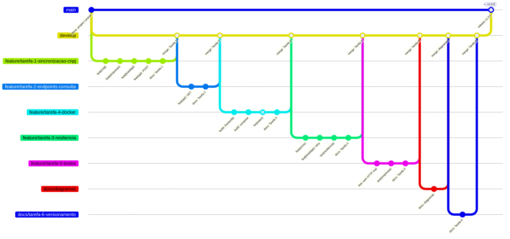
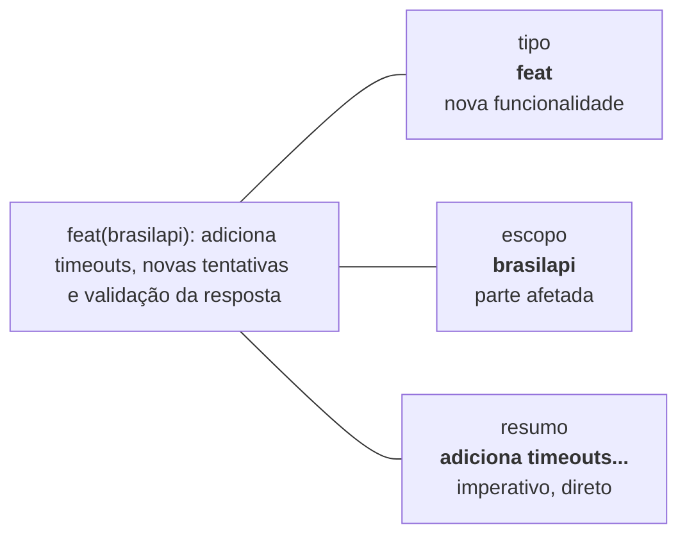

# Tarefa 6: Versionamento com Git

> Todo o desenvolvimento deve ficar registrado num repositório Git: criar o repositório, fazer
> commits durante o desenvolvimento com mensagens claras e descritivas, organizar o trabalho
> em branches e disponibilizar o histórico de versionamento.

## Estratégia de branches

Usamos um **Git Flow simplificado**:

| Branch | Papel | Recebe código de |
|---|---|---|
| `main` | Versão **estável**, entregue. Cada entrega ganha uma tag (`v1.0.0`) | Só de `develop`, por merge |
| `develop` | Integração: junta as tarefas prontas | Branches `feature/*` e `docs/*` |
| `feature/tarefa-N-...` | Uma branch para cada tarefa, com o código e os testes dela | Nasce de `develop` e volta para `develop` |
| `docs/...` | Mudanças só de documentação | Nasce de `develop` e volta para `develop` |

Todos os merges usam `--no-ff` (sem *fast-forward*), para que **cada tarefa apareça como um
bloco no histórico**, com um commit de merge dizendo qual tarefa entrou.

## Histórico



> A Tarefa 4 foi integrada antes da 3 porque o Docker era necessário para rodar o projeto
> sem PHP instalado. O commit `fix(testes)` (marcado em destaque no gráfico) corrige um problema
> encontrado nessa etapa e está explicado na [Tarefa 4](TAREFA-4.md#problema-encontrado-durante-o-desenvolvimento-bom-para-o-debate).

### Commits por tarefa

| Branch | Commit | O que faz |
|---|---|---|
| `main` | `chore: cria projeto Laravel 13 com scaffolding de API` | Esqueleto do Laravel + `install:api` |
| `feature/tarefa-1-sincronizacao-cnpj` | `feat(cnpj): adiciona limpeza e validação de CNPJ` | `Support/Cnpj`, `Rules/CnpjValido`, testes unitários |
| | `feat(empresas): cria tabela e model de empresas` | Migration com `cnpj` UNIQUE + Model |
| | `feat(brasilapi): integra consulta de CNPJ na BrasilAPI` | Service, exceções, `config/services.php` |
| | `feat(api): adiciona endpoint POST /api/empresas com gravação idempotente` | Form Request, Resource, Controller, rota, testes |
| | `docs: documenta a Tarefa 1` | |
| `feature/tarefa-2-endpoints-consulta` | `feat(api): adiciona listagem paginada e consulta de empresa por CNPJ` | `index()`, `show()`, rotas, testes |
| | `docs: documenta a Tarefa 2` | |
| `feature/tarefa-4-docker` | `build(docker): adiciona Dockerfile da aplicação (PHP 8.4 + Apache)` | Dockerfile, entrypoint, Apache, `.dockerignore` |
| | `build(docker): adiciona docker-compose com MySQL, rede e volume persistente` | |
| | `fix(testes): impede que os testes apaguem o banco MySQL do container` | `<server force="true">` no `phpunit.xml` |
| | `docs: README com instruções do Docker e documentação da Tarefa 4` | |
| `feature/tarefa-3-resiliencia` | `feat(erros): padroniza as respostas de erro da API` | `ApiResponse`, `ApiException`, `bootstrap/app.php` |
| | `feat(brasilapi): adiciona timeouts, novas tentativas e validação da resposta` | |
| | `test(resiliencia): cobre timeout, falha de conexão, retry e respostas inválidas` | 17 cenários |
| | `docs: documenta a Tarefa 3` | |
| `feature/tarefa-5-testes` | `test: bloqueia requisições HTTP reais em todos os testes` | `Http::preventStrayRequests()` |
| | `test(empresas): amplia os testes de persistência, CNPJ inválido e idempotência` | |
| | `docs: documenta a Tarefa 5` | |
| `docs/diagramas` | `docs: adiciona diagramas Mermaid ao README e à documentação das tarefas` | |
| `docs/tarefa-6-versionamento` | `docs: documenta a Tarefa 6` | Este arquivo |

## Padrão das mensagens de commit

Seguimos o [Conventional Commits](https://www.conventionalcommits.org/pt-br/v1.0.0/), com as mensagens em português:

```
<tipo>(<escopo opcional>): <resumo no imperativo, em até ~72 caracteres>

<corpo opcional: O QUE mudou e POR QUÊ, não "como">
```



| Tipo | Quando usar | Exemplo neste projeto |
|---|---|---|
| `feat` | Funcionalidade nova | `feat(api): adiciona listagem paginada...` |
| `fix` | Correção de bug | `fix(testes): impede que os testes apaguem o banco MySQL...` |
| `test` | Só testes | `test(resiliencia): cobre timeout...` |
| `docs` | Só documentação | `docs: documenta a Tarefa 3` |
| `build` | Docker, dependências, build | `build(docker): adiciona Dockerfile...` |
| `chore` | Tarefas de manutenção | `chore: cria projeto Laravel 13...` |
| `merge` | Merge de uma branch de tarefa | `merge: Tarefa 3 - resiliência e tratamento de exceções` |

Por que isso ajuda: dá para filtrar o histórico (`git log --grep="^fix"` mostra só as correções),
gerar *changelog* automático e, na revisão, entender o commit só pela primeira linha.

## Como ver o histórico

```bash
git log --oneline --graph --all          # gráfico de todas as branches
git log --first-parent --oneline main    # só as entregas na main
git log --grep="^feat" --oneline         # só as funcionalidades
git show 513db77                         # detalhes de um commit (ex.: o fix dos testes)
git tag -n                               # versões publicadas
```

## Como publicar o repositório (GitHub, GitLab...)

O repositório está pronto localmente, com todas as branches e a tag. Para disponibilizar online:

```bash
# 1. Crie um repositório VAZIO no GitHub (sem README nem .gitignore)
# 2. Conecte e envie tudo (todas as branches e as tags):
git remote add origin https://github.com/<usuario>/cnpj-api.git
git push -u origin --all
git push origin --tags
```

O `.gitignore` já impede que `.env` (segredos), `vendor/` e o banco SQLite local vão para o repositório.

## Pontos para debate com a equipe

1. **Git Flow vs Trunk-based:** com uma equipe pequena e deploy contínuo, muitos times preferem
   trabalhar direto na `main` com branches curtas. O Git Flow mostra bem a organização por tarefa, mas tem mais etapas.
2. **Pull Requests:** num time, cada `feature/*` viraria um PR revisado antes do merge, com os testes rodando no CI.
3. **Merge vs Rebase/Squash:** escolhemos `--no-ff` para manter visível o bloco de cada tarefa. O
   *squash* deixaria um commit por tarefa, com histórico mais limpo e menos detalhe.
4. **Proteção de branch:** no GitHub, dá para bloquear push direto na `main` e exigir PR + testes passando.
5. **Branches antigas:** depois do merge, as `feature/*` podem ser apagadas. Mantivemos para o histórico ficar mais fácil de ver na avaliação.
